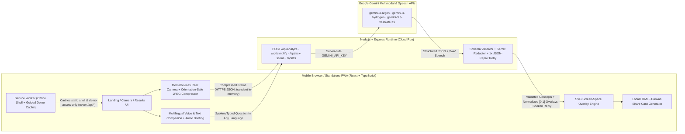

# SeeMathEverywhere

> **“The world is the textbook.”**

**SeeMathEverywhere** is a mobile-first, installable full-stack Progressive Web App (PWA) that reveals the mathematics and physics happening in the real world around you. Point your smartphone camera at a skyline, river reflection, bridge, moving ferry, shadow, or everyday scene, tap **Find the Math**, and explore interactive screen-space visual overlays paired with accessible equations and real-world engineering applications.

---

## 1. The Educational Problem

Students frequently ask *"When am I ever going to use this?"* because mathematics and physics are often taught as abstract symbols detached from physical intuition. Traditional EdTech apps focus on scanning paper worksheets to solve homework problems—reinforcing rote answer-seeking rather than curiosity.

**SeeMathEverywhere** flips that dynamic: it is **not** a homework solver. It is an outdoor and everyday discovery lens designed to connect textbook equations ($\theta_i = \theta_r$, $h_1/d_1 = h_2/d_2$, $v = \Delta x / \Delta t$) directly to visible phenomena in front of the learner.

---

## 2. Core User Flow

1. **Open the public URL** on Android or iPhone (or install to the home screen as a standalone PWA).
2. **Read a single-sentence introduction** on a high-contrast, dark-adapted landing screen.
3. **Tap “Start Camera”** (or **“Try a Demo”** for an instant offline-ready Guided Demo of the Manhattan waterfront at night).
4. **Grant rear-camera permission** (with automatic photo-upload fallback and clear iOS/Android permission recovery instructions if denied).
5. **Point at a real-world scene** using the flash-independent low-light viewfinder and tap **“Find the Math.”**
6. **Inspect 3 to 5 discovered concepts** as the captured frame freezes and screen-space SVG overlays highlight geometry (electric cyan) and physics (warm amber).
7. **Interact & adapt depth**:
   - **See It**: Highlights the exact visual evidence on the captured photograph.
   - **Explain It**: Connects the visible feature to the equation, with a **Simplify** selector across *Elementary*, *Middle*, *High School*, and *College / Adult* levels.
   - **Why Do I Care?**: Explains concrete applications in navigation, architecture, surveying, robotics, optics, and computer graphics.
8. **Share**: Generate a local Canvas-rendered discovery card (`1080 × 1350` PNG) with Web Share API support and one-tap PNG download fallback.

---

## 3. Architecture



---

## 4. Google AI Studio & Gemini Usage

- **SDK**: Built with the official `@google/genai` SDK exclusively inside `server.ts`.
- **Protected Credentials**: `GEMINI_API_KEY` is read strictly on the server via `process.env.GEMINI_API_KEY` and is never bundled into or exposed to browser code, sourcemaps, logs, share cards, or Git commits.
- **Structured Multimodal Analysis**: `POST /api/analyze` submits the compressed camera frame alongside a strict `responseSchema` (`Type.OBJECT`) instructing Gemini (`gemini-4-argon`, with automatic backoff fallback to `gemini-4-hydrogen`) to ground every concept in visible evidence, normalize overlay coordinates in `[0, 1]`, distinguish `"qualitative"` principles from `"estimated"` uncalibrated visual estimates, and avoid hallucinating exact physical measurements.
- **Resilient Validation & Repair**: Responses are validated on the server (`src/utils/validation.ts`). If Gemini returns malformed or schema-incomplete JSON, `analyzeSceneWithRetry` automatically executes one targeted JSON-repair pass before returning clean, user-friendly feedback.
- **Adaptive Reading Levels**: `POST /api/simplify` uses `gemini-4-hydrogen` to rewrite live explanations concisely for Elementary, Middle School, High School, or College/Adult readers.
- **Composed British Field Voice & Multilingual Scene Q&A**:
  - `POST /api/tts` uses `gemini-3.8-flash-lite-tts` (with `gemini-3.8-flash-tts` fallback and `Charon` voice configuration) to deliver one-tap **Voice Briefings** and per-card **Listen** narrations with equations translated into natural spoken phrasing.
  - `POST /api/ask-scene` enables users to speak or type follow-up questions about the captured scene in **any language**, automatically responding—both in text and synthesized speech—in that **exact same language** while highlighting the matching visual overlay on the photograph.

---

## 5. Environment Variables

Copy `.env.example` to `.env` for local development:

| Variable | Required | Description |
| :--- | :--- | :--- |
| `GEMINI_API_KEY` | **Yes** (for live analysis) | Server-side Gemini API key (automatically injected in Google AI Studio; set via Secret Manager on Cloud Run). |
| `GEMINI_MODEL` | No | Optional model override. Defaults to `gemini-4-argon` (with automatic fallback to `gemini-4-hydrogen`). |
| `PORT` | No | HTTP server port. Defaults to `3000` locally; Cloud Run automatically injects `PORT` (typically `8080`). |
| `APP_URL` | No | Public deployment URL injected by AI Studio / Cloud Run. |

---

## 6. Local Setup

```bash
# 1. Install dependencies
npm install

# 2. Configure your Gemini API key in .env
cp .env.example .env

# 3. Run unit tests (validation, coordinate clamping, geometry, JSON-repair retry)
npm test

# 4. Start full-stack development server on http://localhost:3000
npm run dev

# 5. Build and run production server locally
npm run build
npm start
```

---

## 7. Google Cloud Run Deployment

SeeMathEverywhere is architected for direct deployment from **Google AI Studio** to **Google Cloud Run** (or via `gcloud run deploy`):

1. **Build step**: `npm run build` compiles the React + Tailwind CSS frontend and PWA assets into `dist/`.
2. **Runtime start command**: `npm start` executes `node server.ts`, binding to `0.0.0.0` on `process.env.PORT || 3000`, serving static PWA assets (`.webmanifest` with `application/manifest+json` and `sw.js` with `Service-Worker-Allowed: /`) alongside protected `/api/analyze` and `/api/simplify` endpoints.
3. **Secrets**: Attach `GEMINI_API_KEY` as a Cloud Run environment secret—no client-side rebuild is needed when rotating keys.

---

## 8. Privacy Considerations

- **Zero Image Persistence**: Captured or uploaded images are resized in browser memory, transmitted over HTTPS for single-turn Gemini analysis, processed purely in Node.js memory, and discarded immediately after the response completes.
- **No Raw Image Logging**: Server logs record only high-level status/error codes—never base64 image payloads or user photos.
- **Service Worker Isolation**: `public/sw.js` caches only the static application shell and bundled Guided Demo assets. All `/api/*` requests bypass cache (`Cache-Control: no-store`).
- **Honest Calibration**: Uncalibrated monocular camera frames cannot measure exact physical distances or speeds; approximate quantities are explicitly labeled as **Visual estimates**.

---

## 9. Known Limitations

- **Screen-Space Annotations vs. True 6DoF AR**: For distant skylines and dark waterfront scenes where mobile LiDAR/depth sensors cannot range across rivers, overlays are anchored in normalized 2D screen space (`[0, 1]`) on the frozen frame rather than live 3D world-space SLAM.
- **Extreme Darkness / Motion Blur**: Severely underexposed or heavily motion-blurred frames may lack sufficient visual edges; the app detects insufficient detail and suggests framing lit buildings, water reflections, wakes, ramps, or repeating patterns.
- **Live Camera Requires Secure Context**: Browser `getUserMedia` requires HTTPS (provided automatically by AI Studio and Cloud Run) or `localhost`.

---

## 10. Demo Instructions (Waterfront & Indoor Judge Walkthrough)

- **Outdoor Nighttime Waterfront**: Tap **Start Camera**, align the subtle cyan horizon guide with the shoreline/skyline, hold steady for half a second, and tap **Find the Math** to uncover specular water reflection ($\theta_i = \theta_r$), perspective ratios, boat velocity vectors, and facade coordinate grids.
- **Zero-Network / Indoor Judge Backup**: Tap **Try a Demo** on the landing screen (clearly badged **Guided Demo**). It works without camera permissions, API keys, or cellular connectivity—including instant offline switching across all four **Simplify** reading levels and local **Share Card** PNG export.

---

## 11. Hackathon Provenance

Created as a full-stack mobile-first Progressive Web App leveraging Google AI Studio, the `@google/genai` multimodal SDK, and Google Cloud Run for real-world STEM discovery.

---

## 12. License

Copyright (C) 2026 Frank Ivey

This program is free and open-source software licensed under the **GNU Affero General Public License v3.0 only (`AGPL-3.0-only`)** — the strictest OSI-approved copyleft open-source license.

- Any modifications, derivative works, or redistributions **must** remain open source under the exact same **GNU AGPLv3** license, preserve copyright and license notices, and document changes made.
- **Network / Cloud Use (Section 13)**: Anyone who modifies **SeeMathEverywhere** and hosts it over a network or web service must prominently offer all network users the Complete Corresponding Source Code of that modified version under the GNU AGPLv3.
- This program is distributed in the hope that it will be useful, **without any warranty**; without even the implied warranty of merchantability or fitness for a particular purpose.

See the full license text in [`LICENSE`](./LICENSE).

